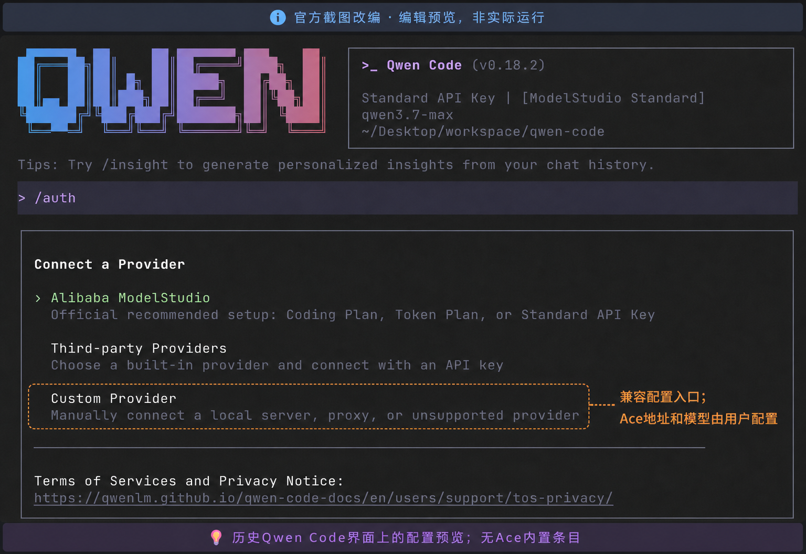

# Suno by Ace Data Cloud：Qwen Code 原生扩展

通过 Ace Data Cloud 生成 Suno 音乐，并查询同一任务的音频结果。 每个服务独立安装、独立输入凭据，复用现有托管 MCP；不会安装其它四项，也不会自动增加 LLM 服务商。

**源码预发行版 `0.1.0-rc.1`。** 本服务可独立安装源码，但未获 Qwen 官方收录或默认内置，也未达到真实媒体鉴权正式可用；下文官方 CLI 运行依赖仍未发布。

**当前运行阻塞（2026-10-18）**：Qwen 0.25.2 能安装并安全保存敏感设置，但 MCP 加载器没有把该存储值展开到 HTTP Header，已报 [上游 #14532](https://github.com/QwenLM/qwen-code/issues/14532)。安装/Connected 不代表鉴权可用；在上游修复验证并发布前，本候选不应执行真实媒体请求。不提供把真实 Token 写进明文配置的绕过办法，也不自动付费重试。

[English](../README.md) · [注册/登录与应用列表](https://platform.acedata.cloud/console/applications?utm_source=github&utm_medium=referral&utm_campaign=evergreen&utm_content=sunoqwencode_readme_signup) · [当前价格](https://platform.acedata.cloud/models?utm_source=github&utm_medium=referral&utm_campaign=evergreen&utm_content=sunoqwencode_readme_pricing)

## 1. 通过 Qwen 原生扩展命令安装

```bash
qwen extensions install AceDataCloud/SunoQwenCode
```

安装验证基线为 Qwen0.25.2、Node22；真实鉴权仍需等待下文所述修复版。如需固定源码版本，在安装命令增加 `--ref v0.1.0-rc.1`。当前未修复官方 CLI 只输入合成占位值，不使用真实 Token 或调用托管 MCP；待修复版核验后再按下文输入自己的 Token。也可按 [Ace 目录说明](https://github.com/AceDataCloud/AceDataCloudQwenCode) 添加来源，在 `/extensions manage` → Discover 搜 **Suno**。用户添加目录不代表 Qwen 默认市场收录。

## 凭据存储与已验证平台边界

**真实 Token 使用必须等待包含[修复 #14544](https://github.com/QwenLM/qwen-code/pull/14544) 的官方 Qwen 版本发布并复验。** 0.25.2 只是安装基线，不是鉴权已修复版本；目前没有已核验的修复发行版。

[当前 head 验证](https://github.com/AceDataCloud/qwen-code/actions/runs/39142135018)针对精确候选 `77b2196` 构建 core，通过真实密钥存储、加载器及 transport 向 localhost 初始化，未强制后端；macOS/Windows 各26项、Linux正常加密文件25项通过，不等于官方修复已发布：

| 环境 | 实际选择的后端 | 验证结果 |
|---|---|---|
| Windows Server2022 x64，Node22.23.3 | keytar 系统凭据存储（`keychain`） | 26 项通过，含保存设置→Header→localhost 初始化；仅覆盖该托管会话，不覆盖所有用户权限/锁定状态。 |
| Linux x64，Node22.23.3 | Qwen 正常选择的 `encrypted_file` 加密文件后备 | 25 项通过；runner 系统 Secret Service 不可用，不能声称 Linux Keychain 已验。 |
| macOS arm64，Node22.23.3 | 真实系统 Keychain；修复补验26项通过 | 原matrix在工作区路径别名处失败；[定向修复验证](https://github.com/AceDataCloud/qwen-code/actions/runs/39120588598)统一物理目录身份后，user/workspace/未信任目录Header握手及故障处理通过。修复候选现为head77b2196，仍未发布，旧matrix失败保留。 |

本轮 Windows/Linux 补验构建 core 并使用真实存储/加载器/transport，不等于这两个平台完整交互 CLI 或已发布版本验收；既有 macOS 源码构建 CLI 证据单列。

安装器在 `.qwen-extension-settings.json` 记录后端，不需复制或展示密钥 bundle。系统后端不可用时，Qwen 原有机制可以选择加密文件，它不是明文 Token 后备。安装后既定存储缺失/不可读应视为故障，不能静默换凭据；修复候选会保留管理入口、禁用 MCP。应先核查存储可用性并重试/重载，不因临时锁定或后端不可用就卸载；确认设置缺失/损坏后先备份可恢复设置，再考虑重装。重装可能保留既有 workspace override，需要时通过隐藏输入核查/轮换相应 scope。不要全局导出 Token、强制换后端、写入 manifest/参数，或解锁 Keychain/修改 OS 权限来绕过候选阻塞。

## 2. 注册、进入 General application、复制或创建 Token

打开 [Applications](https://platform.acedata.cloud/console/applications?utm_source=github&utm_medium=referral&utm_campaign=evergreen&utm_content=sunoqwencode_readme_api_key) 并注册/登录。没有通用应用时先点 **Initialize General Application**；进入 **General application**，复制 API Key，或 **Manage Keys → Create** 创建名为 `Suno Qwen Code` 的独立 Key。


核对本服务权限、当前价格、余额、有效期和用量限制；若限制 Allowed APIs，需要包含选定操作用到的 `/suno/audios`, `/suno/tasks`。按需限制，不能把任务查询权限当成生成权限。只复制原始 Token，不含 Bearer 或引号；`platform-...` 管理 Token 不可替代。


以上为共用 Ace 应用页真实截图，来自 2026-10-07 固定 SunoDify 教程，2026-10-18 复用；Key 已遮盖，不代表你的账户权益。

## 3. 粘贴到本扩展的敏感设置

当前源码预发行在未修复官方 CLI 中只输入合成占位值，不调用托管 MCP。修复发行版核验后，才在 **Ace Data Cloud API Token** 隐藏输入框粘贴真实 Token。凭据由 Qwen 的 keychain/加密文件后备存储管理；扩展 JSON 只保存变量名 `ACE_SUNO_API_TOKEN`。不把 Key 放到聊天、脚本参数或共享配置，也不执行 `qwen mcp add` 重复添加。

```bash
qwen extensions settings set suno-by-ace-data-cloud "Ace Data Cloud API Token"
```

上面命令用于后续轮换，Token 在隐藏提示框输入。重启已有会话后 `/mcp` 检查 `suno` 连接；连接不是业务成功。



该图为 v0.18.2 官方终端截图于 2026-10-17 编辑，标的是另一个手动模型设置入口，**不是本扩展凭据框或 Ace 实测结果**；当前扩展设置真实截图已排队，不能用预览声称上线。

## 4. 首用与查询原任务

Qwen 的对话模型另行配置；模型对话本身可能收费。先查看工具定义，或调用仅列模型信息的 `suno_list_models`；不凭空发生成测试。

确需媒体时，选当前允许的明确模型、输入和预算后授权一次 `suno_generate_music`。保存返回的 task_id，使用 `suno_get_task` 的 `task_id` 查询**同一 ID**。pending 时继续查原 ID，不重跑生成；保留失败/限流/权限错误，不自动切模型。终态成功和可用媒体链接都确认后才展示结果；GPT Image 的 finished_at 只表示终态，失败也会设置；还要检查 response.error / response.success，不能把终态一律当成功。候选包不声称已有付费结果图。

## 常见问题

- 401/403：核对完整原始 Token、应用权限、余额、过期与 Allowed APIs。
- 找不到工具：重启、查看 `/extensions manage`、`/mcp`；同名手工 MCP 配置会覆盖扩展。
- 非交互 permission declined：只授权需要的工具，不默认信任整个服务器。
- pending/超时：查原任务，不自动发新收费请求；429 按响应退避。

[隐私](../PRIVACY.md) · [当前价格](https://platform.acedata.cloud/models?utm_source=github&utm_medium=referral&utm_campaign=evergreen&utm_content=sunoqwencode_readme_pricing) · [原有工具实现](https://github.com/AceDataCloud/SunoMCP)。这是 Ace 提供的集成，不冒充 Suno 或 Qwen 官方。
